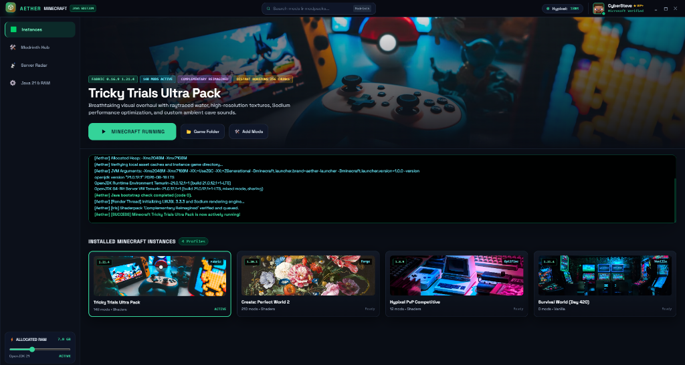
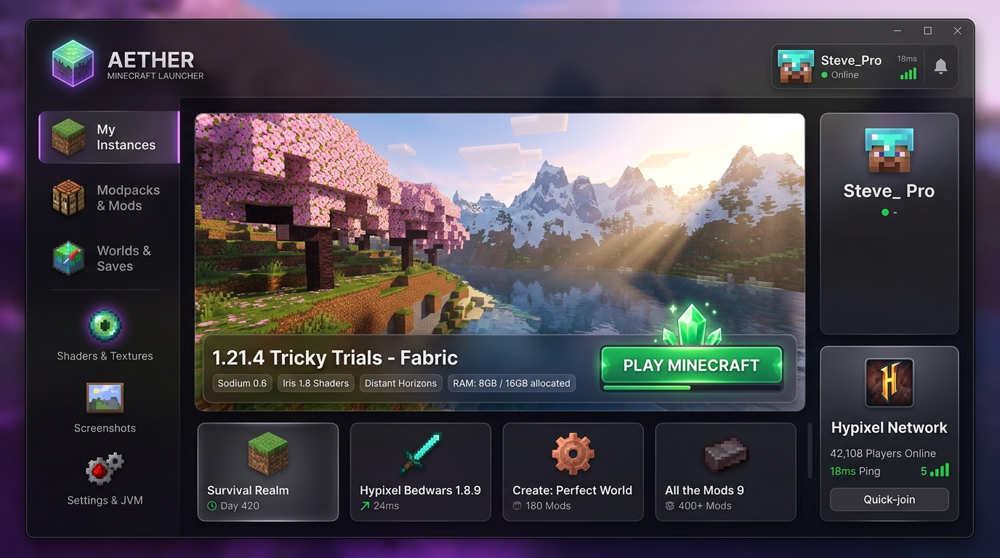
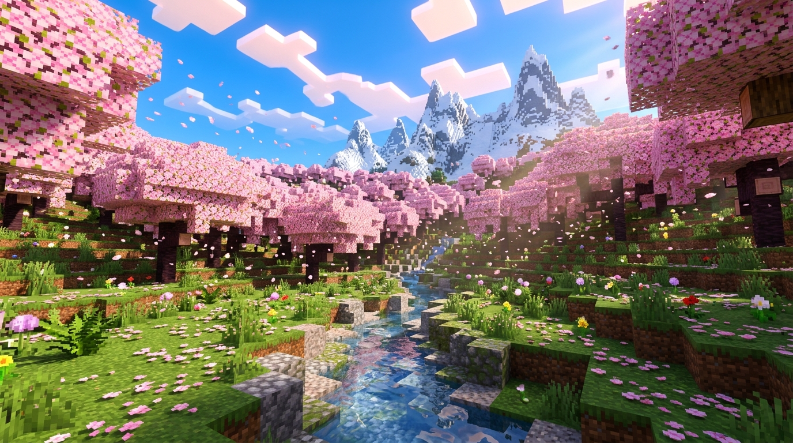
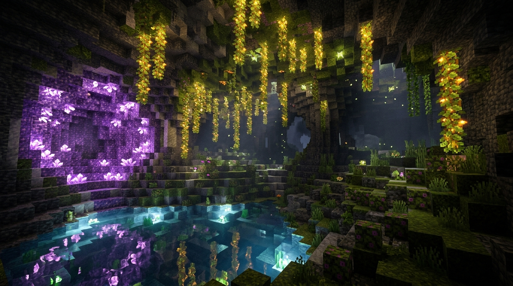

<div align="center">

# ✨ Ather Launcher (Aether)
### The Next-Gen Obsidian & Emerald Minecraft Client & Modding Environment

[](https://github.com/Yugraj20/AtherLauncer/releases/tag/v1.0.0)
[](https://minecraft.net)
[](https://github.com/Yugraj20/AtherLauncer/releases)
[](https://yugraj20.github.io/AtherLauncer/)
[](LICENSE)

<br/>



<br/>
<br/>

**Ather Launcher** is an ultra-fast, modern Minecraft launcher engineered with a dark bedrock & obsidian glassmorphic aesthetic, animated ambient splash sequence, built-in Modrinth addon management, real-time Server Radar, emergency process kill switch, and **Ather's Choice** curated modpack presets.

[🌐 Explore 3D Website](https://yugraj20.github.io/AtherLauncer/) • [⚡ Download Installer](https://github.com/Yugraj20/AtherLauncer/releases/download/v1.0.0/Aether.Launcher.Setup.1.0.0.exe) • [📦 Download Portable (.zip)](https://github.com/Yugraj20/AtherLauncer/releases/download/v1.0.0/Aether-Launcher-1.0.0-Portable.zip)

</div>

---

## ⚡ Instant Downloads (v1.0.0 Release)

| Package | Type | File Size | Description | Download |
| :--- | :---: | :---: | :--- | :---: |
| **Ather Launcher Setup** | Installer `.exe` | `~87.7 MB` | Standard Windows NSIS setup wizard with desktop shortcut & start menu | [⚡ Download Setup](https://github.com/Yugraj20/AtherLauncer/releases/download/v1.0.0/Aether.Launcher.Setup.1.0.0.exe) |
| **Ather Launcher Portable** | Portable `.zip` | `~123 MB` | Standalone zero-install archive. Extract anywhere and double-click `Aether Launcher.exe` | [📦 Download Portable](https://github.com/Yugraj20/AtherLauncer/releases/download/v1.0.0/Aether-Launcher-1.0.0-Portable.zip) |

---

## 🌟 Highlights & Key Features

### 1. ✨ "Ather's Choice" Curated 26.3 Presets (Cloud On-Demand)
Ather Launcher comes out of the box with 5 official hand-crafted configurations for Minecraft `26.3` (Fabric). Presets do not take up space until you click **PLAY**, which triggers an automated on-demand download of all required mods, resource packs, shaders, Fabric loader, and Minecraft client files:

| Preset Name | Target Style | Key Mods & Shaders | Image Preview |
| :--- | :--- | :--- | :---: |
| **Hyperion FPS Boost** | Competitive / Max FPS | Sodium, Lithium, FerriteCore, ImmediatelyFast, MakeUp UltraFast Shader |  |
| **RTX Cinematic Shaders** | Ultra Raytracing | Iris, Sodium, Entity Model Features, Complementary Reimagined, BSL |  |
| **Survival+ Explorer** | Adventure & QoL | Xaero's World Map & Minimap, JEI, Jade, AppleSkin, Complementary Unbound |  |
| **Multiplayer SMP Pro** | SMPs & Bedwars | Simple Voice Chat, 3D Skin Layers, LowOnFire, EntityCulling, Solas |  |
| **Realism & Immersion** | Next-Gen Visuals | Photon Shader, Mellow Shader, Fresh Animations + Extensions, EMF, ETF |  |

---

### 2. ⚡ Emergency Process Kill Switch
Never open Task Manager to kill a frozen Minecraft window again. Ather Launcher features an emergency **Kill Switch** that cleanly detects the active game process tree and performs a safe tree termination (`taskkill /t /f`) with a custom Obsidian confirmation popup dialog.

<div align="center">
  
</div>

---

### 3. 🧩 Integrated Modrinth Ecosystem (Mods, Resource Packs & Shaders)
Manage your instance addons directly in-app:
- 1-Click Search and Install from millions of Modrinth projects.
- Dedicated tabs for **Installed Mods**, **Resource Packs**, and **Shader Packs**.
- Instant enable/disable toggle without deleting files.
- Dedicated **Game Folder** and **Folder Type** buttons right inside each menu.

---

### 4. 📡 Server Radar & "Copy & Launch" Instance Picker
- Real-time online player count and ping status for Hypixel, Wynncraft, DonutSMP, and Hoplite.
- **Copy & Launch**: Clicking copies the server IP to your clipboard and opens an instance selector popup modal showing your instances and Ather's Choice presets with their addon badges (`Mods • Packs • Shaders`).

---

### 5. 🎨 Obsidian Glass UI & 25-Image Minecraft Wallpaper Gallery
- Every instance randomly draws from a curated 25-image gallery of high-resolution Minecraft landscapes (cherry blossom groves, lush amethyst caverns, raytraced golden-hour sunsets, and mountain peaks).
- Dynamic 20:80 animated hover action bar on each instance card (`⚙️ 20% Settings` : `▶ 80% Play`).
- Animated intro splash screen with orbital logo spin and backdrop blur.

---

### 6. 🛡️ Official Microsoft Authentication (Zero Piracy)
Ather Launcher strictly enforces official Minecraft Java authentication through Microsoft OAuth 2.0 and Mojang's cryptographic identity services (`api.minecraftservices.com`). Automatic token refresh keeps you logged in securely without storing plain-text passwords.

---

## 📸 Screenshots Showcase

<div align="center">
  <table>
    <tr>
      <td><br/><center><b>Cherry Blossom RTX</b></center></td>
      <td><br/><center><b>Lush Amethyst Cavern</b></center></td>
    </tr>
    <tr>
      <td><br/><center><b>Raytraced Sunset Water</b></center></td>
      <td><br/><center><b>Ather Launcher Interface</b></center></td>
    </tr>
  </table>
</div>

---

## 🛠️ Building & Developing From Source

### Prerequisites
- [Node.js](https://nodejs.org/) (v18.x or v20.x+ recommended)
- Java Runtime (Java 8, 17, 21, or 25)
- Git

### Quick Setup

```bash
# 1. Clone the repository
git clone https://github.com/Yugraj20/AtherLauncer.git
cd AtherLauncer

# 2. Install dependencies
npm install

# 3. Launch in development mode
npm start

# 4. Package executable installer and portable release
npm run dist
```

Build outputs will be generated in `dist/`:
- `dist/Aether Launcher Setup 1.0.0.exe` (NSIS Installer)
- `dist/win-unpacked/` (Portable Unpacked Directory)

---

## 📂 Project Architecture

```
AtherLauncer/
├── src/
│   ├── main/
│   │   ├── main.cjs             # Electron main process & IPC coordinator
│   │   ├── launcher.cjs         # Core Minecraft game launch engine & Ather's Choice manager
│   │   ├── mojang-installer.cjs # Mojang API, version manifest, client & asset resolver
│   │   ├── fabric-installer.cjs # Fabric Knot loader resolver & ASM collision prevention
│   │   ├── optifine-installer.cjs# OptiFine shader module installer
│   │   ├── java-detector.cjs    # Local Java runtime scanner & environment resolver
│   │   ├── java-manager.cjs     # Automatic Java version resolver (Java 8/17/21/25)
│   │   ├── auth-manager.cjs     # Official Microsoft MSA OAuth2 & Mojang auth
│   │   └── modrinth.cjs         # Modrinth REST API search & 1-click installation
│   └── renderer/
│       ├── index.html           # Obsidian glassmorphic launcher interface
│       ├── style.css            # Tailwind + custom CSS3 glassmorphism & keyframe animations
│       ├── app.js               # Reactive UI controller, state engine & audio feedback
│       └── assets/              # Banners (25-image gallery), launcher icon & UI textures
├── docs/                        # 3D Three.js interactive showcase website (GitHub Pages)
│   ├── index.html               # 3D interactive voxel WebGL scene & product page
│   └── assets/                  # WebGL textures & showcase imagery
├── media/                       # High-resolution screenshots & release illustrations
├── package.json                 # Electron & electron-builder configuration
└── README.md                    # Project documentation
```

---

## 🖥️ System Requirements

| Specification | Minimum | Recommended |
| :--- | :--- | :--- |
| **Operating System** | Windows 10 (64-bit) | Windows 11 (64-bit) |
| **Processor** | Intel Core i3 / AMD Ryzen 3 | Intel Core i5/i7 / AMD Ryzen 5/7 |
| **RAM** | 4 GB | 16 GB (Allocated: 6–8 GB) |
| **Graphics** | Intel HD 4000 / AMD Radeon | NVIDIA GeForce GTX 1060 / RTX 3060+ |
| **Disk Space** | 2 GB free space | 10 GB+ SSD space |

---

## ⚖️ Disclaimer & Legal

**Ather Launcher** is an open-source community client and is **NOT** an official Minecraft product. It is not approved by or associated with Mojang Studios, Microsoft Corporation, or Modrinth. All Minecraft assets, names, and trademarks belong to Mojang Studios / Microsoft.

---

## 📜 License

Distributed under the **MIT License**. See [`LICENSE`](LICENSE) for details.
